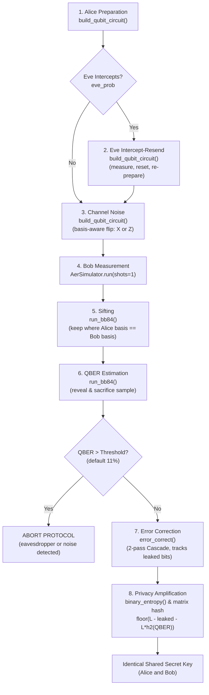

# Interactive BB84 and QBER Visualizer

An educational quantum cryptography simulator demonstrating the complete **BB84 Quantum Key Distribution (QKD)** protocol using real quantum circuits on Qiskit and an interactive Streamlit user interface.

---

## What is BB84?

BB84 is the foundational Quantum Key Distribution protocol invented in 1984 by Charles Bennett and Gilles Brassard. It enables two communicating parties—conventionally called **Alice** and **Bob**—to establish a shared secret cryptographic key across an insecure public channel, guaranteed by the fundamental laws of quantum physics rather than computational assumptions. Alice encodes random bits into single photons using two non-orthogonal measurement bases (rectilinear $+$ and diagonal $\times$). According to the **Heisenberg uncertainty principle** and the **no-cloning theorem**, an eavesdropper (**Eve**) cannot measure or copy an unknown quantum state without unavoidably disturbing it. By publicly comparing their measurement bases (sifting) and sacrificing a small fraction of their bits to measure errors (Quantum Bit Error Rate, or **QBER**), Alice and Bob can detect any eavesdropping attempt. If the QBER is safely below an abort threshold (typically 11%), they reconcile remaining errors and distill an identical, provably private encryption key.

---

## Project Structure

```text
bb84/
├── engine.py           # Pure Qiskit quantum circuit generation, simulation, and post-processing math
├── app.py              # Streamlit web UI with synchronized controls, stage tabs, and Plotly charts
├── run.py              # Single-command launcher that runs tests and starts the Streamlit server
├── hello_qiskit.py     # Milestone 1 sanity check verifying Qiskit Aer circuit batching
├── pytest.ini          # Pytest configuration settings for the test discovery path
├── requirements.txt    # Pinned production and test dependencies
├── README.md           # Project architecture, math guide, and setup instructions
├── .gitignore          # Excludes virtual environment, bytecode, and test caches
├── frontend/           # Standalone client-side web visualizer (HTML/CSS/JS, zero install)
│   ├── index.html      # Responsive visualizer UI with controls, stage progression & chart
│   ├── style.css       # Dark-theme layout and polarization chip styling
│   └── app.js          # Pure JavaScript BB84 simulation, stage state machine & canvas chart
└── tests/
    └── test_engine.py  # 11 deterministic verification tests for all BB84 protocol stages
```

---

## How the Data Flows

The flowchart below maps the entire BB84 protocol lifecycle from photon generation to the final secret key, annotated with the matching functions from `engine.py`:



---

## Mapping Protocol Stages to Code & UI

| Protocol Stage | Function in `engine.py` | Implementation Details | Tab / Location in `app.py` |
|---|---|---|---|
| **1. State Preparation** | `build_qubit_circuit()` | Encodes classical bits into $|0\rangle, |1\rangle, |+\rangle, |-\rangle$ via `X` and `H` gates. | `Protocol` → `1 Prepare` |
| **2. Eavesdropping** | `build_qubit_circuit()` | Eve measures in a random basis, resets the photon (`reset(0)`), and re-prepares matching state (`if_test`). | `Protocol` → `2 Eve` |
| **3. Channel Noise** | `build_qubit_circuit()` | Basis-aware bit-flip: `X` gate if computational $+$, `Z` gate if diagonal $\times$. | `Protocol` → `3 Measure` |
| **4. Measurement** | `run_bb84()` | Bob measures in random basis ($H$ before measurement if diagonal). All $n$ circuits run in one batched call to `AerSimulator`. | `Protocol` → `3 Measure` |
| **5. Sifting** | `run_bb84()` | Discards bits where Alice and Bob used different bases. Retains $\approx n/2$ bits. | `Protocol` → `4 Sift` |
| **6. QBER Estimation** | `run_bb84()` | Sacrifices random sample of sifted bits to estimate error rate. Aborts if $\text{QBER} > \text{threshold}$. | `Protocol` → `5 QBER estimate` |
| **7. Error Correction** | `error_correct()`, `_binary_search_fix()` | 2-pass Cascade parity comparison with binary search; initial block size $k_1 = \max(4, \text{round}(0.73/\text{QBER}))$, pass 2 uses $2k_1$. Counts leaked bits. | `Protocol` → `6 Error correction` |
| **8. Privacy Amplification** | `run_bb84()`, `binary_entropy()` | Compresses key using random binary matrix modulo 2 to length $\lfloor L - \text{leaked} - L \cdot h_2(\text{QBER}) \rfloor$. | `Protocol` → `7 Privacy amplification` |
| **Example Circuit** | `build_qubit_circuit()` | Text drawing of the exact Qiskit circuit for any selected qubit index ($0 \le i < n$). | `Protocol` → Section below stage tabs |
| **Monte-Carlo Experiment** | `run_bb84()` | Sweeps Eve intercept probability $p \in [0, 1]$ over multiple runs per point, plotting mean $\pm$ std vs. theory ($p/4$). | `Experiment` top-level tab |

---

## Setup and Running

### 1. Installation
Inside the `bb84/` directory:
```bash
# Create and activate a Python 3.10+ virtual environment
python3 -m venv .venv
source .venv/bin/activate

# Install exact pinned dependencies
pip install -r requirements.txt
```

### 2. Run the Web Application
```bash
streamlit run app.py
```
Open `http://localhost:8501` in your browser.

#### Using the Synchronized Inputs
Every parameter in the sidebar has **both a number input box and a slider**:
- **Type an exact number** into the input box to immediately update the slider and re-run the simulation.
- **Drag the slider** to dynamically update the number input box.
- Both controls share identical minimum, maximum, and step boundaries:
  - **Number of qubits ($n$):** 20 to 2,000 (step: 10, default: 100)
  - **Eve intercept probability (%):** 0 to 100% (step: 1%, default: 0%)
  - **Channel noise, bit-flip (%):** 0 to 30% (step: 1%, default: 0%)
  - **Sample size for QBER (%):** 5 to 100% (step: 1%, default: 50%)
  - **Abort threshold (%):** 1 to 30% (step: 1%, default: 11%)
  - **Random seed:** Numeric seed (default: 42) for deterministic, reproducible runs

### 3. Run the Automated Tests
```bash
pytest -v
```
Executes 11 unit and statistical tests checking zero-noise baseline, the $p/4$ Eve rule, basis randomness, sample discarding, error correction, and privacy amplification.

### 4. Single-Command Python Launcher
You can also launch everything with one command without manually activating the virtual environment:
```bash
# Run tests and immediately launch the web app
python3 run.py

# Run only the test suite
python3 run.py --test-only
```

### 5. Standalone Web Frontend (Zero Dependencies)
You can also run the client-side JavaScript visualizer directly in any browser without Python or Qiskit:
```bash
open frontend/index.html
```

---

## How to Read the Results

- **The $p/4$ Rule for Eve:** When Eve intercepts a photon with probability $p$, she must guess the basis at random ($50\%$ chance of choosing correctly). If she chooses the correct basis, she introduces zero disturbance. If she chooses the wrong basis, she measures a random result and re-emits in the wrong basis; when Bob later measures in Alice's basis, he gets a random outcome ($50\%$ error rate). Thus, the error rate in the sifted key caused solely by Eve is:
  $$\text{QBER}_{\text{Eve}} = p \times \frac{1}{2} \times \frac{1}{2} = \frac{p}{4}$$
  - At $p = 0\%$ (no Eve): $\text{QBER} \approx 0\%$
  - At $p = 40\%$: $\text{QBER} \approx 10\%$ (near the security threshold)
  - At $p = 100\%$ (full interception): $\text{QBER} \approx 25\%$
- **Estimated QBER vs. True QBER:**
  - **Estimated QBER** is calculated strictly from the randomly sacrificed sample bits ($M$ bits). In real-world QKD, this is the only value Alice and Bob can observe.
  - **True QBER** is calculated across the entire sifted key by the simulator to verify that the sample estimate accurately reflects channel reality.
- **Why the 11% Abort Threshold?**
  In asymptotic BB84 security proofs against general incoherent/coherent eavesdropping (such as the Shor-Preskill bound), the secret key extraction rate is:
  $$R \ge 1 - 2\,h_2(\text{QBER})$$
  Solving $1 - 2\,h_2(\text{QBER}) = 0$ yields $\text{QBER} \approx 11.0\%$. Above this threshold, Eve's mutual information with Alice can equal or exceed Bob's mutual information, making secret key distillation mathematically impossible.

---

## Limitations
- Ideal single photons only (no photon loss, multi-photon pulses or detector imperfections).
- Intercept-resend is the only attack modelled.
- Noise model is an idealised bit flip in the transmission basis (X for the + basis, Z for the × basis). Depolarizing noise would give QBER = 2p/3 instead of p.
- Error correction is simplified (2-pass block parity with binary search, not full Cascade), and its leaked bits are counted.

---

## Known Issues

- **macOS Thread Stack Size (`in_big_thread` in `app.py`):** Streamlit re-runs `app.py` inside a worker `threading.Thread` on every widget interaction. On macOS (Python on arm64), new threads default to a 512 KB stack size, which causes Qiskit's Rust/C++ circuit compiler (`QuantumRegister` / `QuantumCircuit`) to segmentation-fault on subsequent script runs. `app.py` wraps Qiskit calls in `in_big_thread()`, which temporarily sets `threading.stack_size(64 * 1024 * 1024)` in a `try/finally` block before spawning a worker thread and restores the previous setting immediately afterward.
